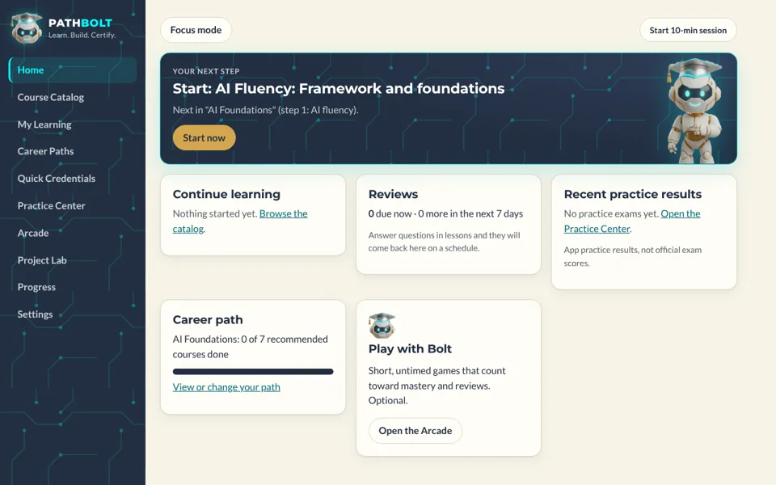
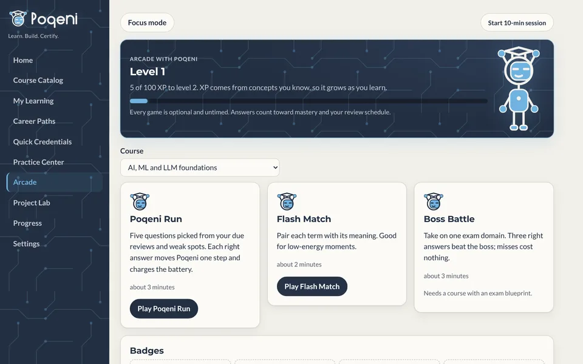
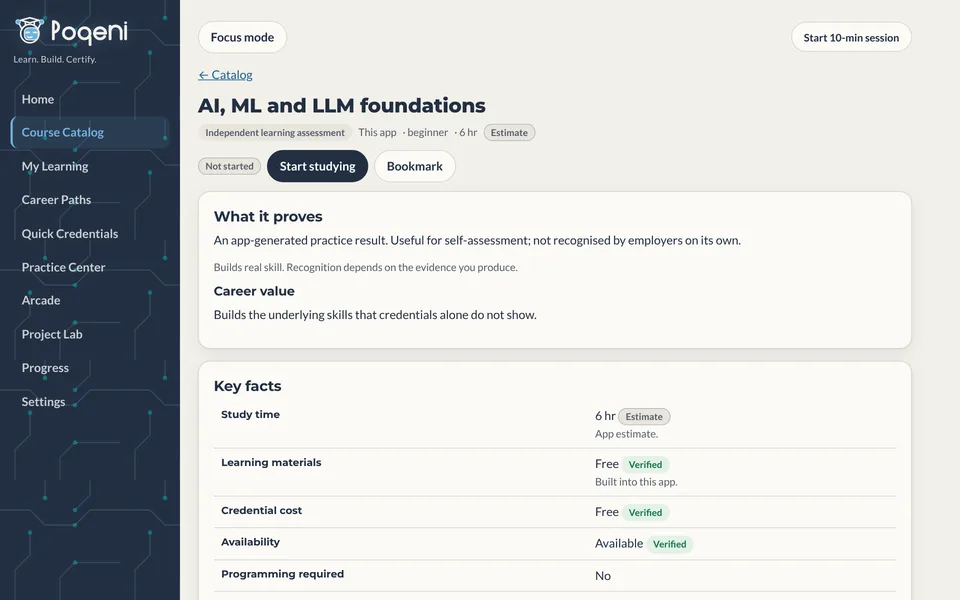
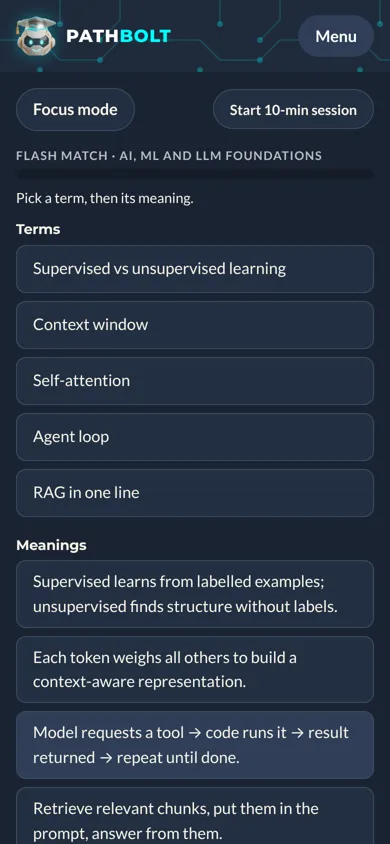

<p align="center">
  
</p>

<h1 align="center">PathBolt</h1>

<p align="center"><strong>Learn. Build. Certify.</strong><br>
A local-first, ADHD-friendly study platform for entry-level AI careers.</p>

<p align="center">
  <a href="https://github.com/jmo7850/AI-cademy/actions/workflows/ci.yml"></a>
</p>

PathBolt brings courses and credentials from Claude Academy, AWS, Microsoft, Google, OpenAI Academy, AMD AI Academy and NVIDIA into one catalog, and adds its own lessons, practice exams, spaced repetition, mastery tracking, career paths, a project lab and an optional games Arcade hosted by Bolt.

No account, server or paid AI API is needed. All progress stays in your browser and can be exported as JSON.

| Dashboard | Arcade |
| --- | --- |
|  |  |
| **Course page with verified facts** | **Phone, dark mode** |
|  |  |

## Contents

- [Quick start](#quick-start)
- [Scripts](#scripts)
- [What is in it](#what-is-in-it)
- [Visual design](#visual-design)
- [Architecture](#architecture)
- [Data sources and accuracy](#data-sources-and-accuracy)
- [Known limitations](#known-limitations)
- [Documentation](#documentation)
- [Contributing](#contributing)

## Quick start

Requires **Node 20 or newer** (see `.nvmrc`).

```bash
git clone https://github.com/jmo7850/AI-cademy.git
cd AI-cademy
npm ci
npm run dev        # open http://localhost:5173
```

On Windows PowerShell the same commands work. If PowerShell blocks scripts, use `npm.cmd ci` and `npm.cmd run dev`.

To build a static site, run `npm run build`. It writes to `dist/`, which any static host can serve, because the app uses hash routing and relative asset paths.

## Scripts

| Command | What it does |
| --- | --- |
| `npm run dev` | Starts the dev server with hot reload. |
| `npm run check` | Type check, lint, unit tests and production build in one go. CI runs this. |
| `npm run typecheck` | TypeScript in strict mode, no emit. |
| `npm run lint` | ESLint with the TypeScript and React Hooks rules. |
| `npm test` | Vitest unit tests (engines, store, catalog integrity). |
| `npm run test:e2e` | Playwright journeys on desktop and a Pixel 7 profile, with axe accessibility scans. Run `npx playwright install chromium` once first, and `npm run build` before it. |
| `npm run build` | Type check, then a production build in `dist/`. |
| `npm run preview` | Serves `dist/` on port 4173. |

## What is in it

| Section | What it does |
| --- | --- |
| Home | One recommended next action with its reason, plus continue-learning, reviews, recent results and path progress. |
| Course Catalog | Search and filter by provider, credential type, subject. Credential classes are kept apart: formal certifications (proctored exams), professional certificate programs, course completion certificates or badges, vendor skill credentials, and learning resources with no credential. Each entry shows every fact with a provenance badge: **Verified** (read on the official page on the date shown), **Unverified**, or **Estimate**. |
| My Learning | Enrolled, bookmarked and custom plans. |
| Career Paths | Five templates (AI Foundations, Cloud and AI, AI Application Developer, AI Agent and Runtime Engineer, Local LLM Developer). Reorder, add, remove, skip or include; every suggestion says why. |
| Quick Credentials | Short courses, badges and beginner certifications with 14 filters and a speed/depth/cost trade-off note. |
| Practice Center | Review queue, weak areas, flashcards, and an exam simulator that follows published domain weights. |
| Arcade | Optional, untimed games hosted by Bolt: **Bolt Run** (5 questions from due reviews and weak concepts), **Flash Match** (pair terms with meanings), **Boss Battle** (beat one exam domain). Every answer is recorded like normal practice, so it updates mastery and the review schedule. Levels come from concept mastery (not time spent), plus badges and a Win board on Progress. Can be hidden in Settings. |
| Project Lab | 9 projects from exercises to capstones, with milestones, definition of done, validation and portfolio entries. |
| Progress | Mastery per concept, activity, study time, review backlog, confidence, status and history. |
| Settings | Preferences, schedule, budget, theme, backup export/restore, course import, delete all data. |

### Learning loop

Lesson sections (one at a time, "Go deeper" is optional) → knowledge check with per-option explanations and an optional confidence rating → answers schedule spaced reviews (missed items return in 10 minutes) → concept mastery updates → weak concepts get a *different* example in targeted review → practice exam by official domain → domain results, weak-area remediation, readiness.

### Status levels kept separate

Not started · In progress · Completed · Practice assessment passed · Demonstrated mastery · External credential recorded. The last one is only what you enter after the provider issues the credential; finishing study never sets it.

### ADHD-friendly design

Applied from [ayghri/i-have-adhd](https://github.com/ayghri/i-have-adhd) (its `SKILL.md` rules): one clear next action first, numbered and visible progress ("Step 4 of 8"), state restated on every screen, details behind expandable sections, concrete time estimates, visible wins, neutral error wording ("Not quite." plus the fix), no streaks, no forced timers. The optional session timer (5/10/20/30 min) offers a break and can be ignored. Focus mode hides navigation. Lessons and exams resume exactly where you left off.

## Visual design

PathBolt (first drawn up as Vector Academy) follows its brand identity board: Deep Navy `#232F42`, Electric Cyan `#00FFFF`, Brushed Gold `#D4A74F`, Metallic Silver `#B4B7BD`, Warm Cream `#F7F4E8`; Montserrat headings and Lato body (Google Fonts, with system fallbacks). Light panels are warm cream; the sidebar and hero card are navy with a faint cyan circuit pattern. Bolt, the mascot, is the logo (head) and stands in the hero card (full figure); both are cut-out images in `src/ui/assets/`, inlined into the build. Cyan is used only on navy or as a glow; links on cream use a deep teal for contrast. Gold marks formal certifications, achievements and the main call to action. All colours are tokens in `src/ui/styles.css`, redefined for dark mode.

## Architecture

```
src/
  domain/types.ts        Catalog, curriculum, question and Fact<T> provenance types
  data/                  Seed content (no logic)
    catalog.ts           42 entries; official facts carry sourceUrl + checkedOn
    curriculum/          10 study courses (lessons, questions, flashcards, blueprints)
    paths.ts projects.ts Career path templates and project lab
    registry.ts          Merges built-in and user-imported content
  engine/                Pure, tested logic (no React)
    grading.ts           All question types; normalised and numeric-tolerance fill answers
    srs.ts               Modified SM-2 using correctness, confidence and difficulty
    mastery.ts           Per-concept mastery, weak areas, readiness, course status
    exam.ts              Blueprint-weighted selection (largest remainder), scoring
    recommend.ts         Path personalisation with reasons; single next action
    games.ts             Arcade picks, charge, XP levels and badges
    catalogFilter.ts     Search, quick-credential filters, trade-offs, staleness
    validate.ts          Import validation (courses and backups)
    tutor.ts             Optional AI tutor interface; default = authored explanations
  store/                 Versioned state, reducer, localStorage persistence + migrations
  ui/                    React pages and components, hash router, Vector theme tokens (light/dark) in styles.css
```

Dependencies: React and Vite at runtime; Vitest, Testing Library/jsdom, Playwright, axe-core and ESLint for development. No state, routing or validation libraries.

### Extending

- **New provider or course:** add a `CatalogEntry` in `src/data/catalog.ts` (use `verified()` only for facts you read on the official page, and set `sourceUrl` and `checkedOn`). Add a `StudyCourse` in `src/data/curriculum/` and register it in `curriculum/index.ts`. `tests/catalog.test.ts` validates links, ids, explanations and blueprint coverage.
- **New exam blueprint:** set `blueprint.domains` with published weights (`weightsStatus: 'verified'`) and give every domain at least one question.
- **Without code:** Settings → Import a course (`aca-course@1` JSON; the format is shown in the app). Imports are always labelled user-added and unverified.
- **Schema change:** bump `SCHEMA_VERSION` in `store/schema.ts` and add a step to `MIGRATIONS` in `store/persistence.ts`.
- **AI tutoring:** implement `TutorProvider` behind a server you control. Never put API keys in client code.

## Data sources and accuracy

Official facts were read on these pages on **2026-10-10** and are flagged "Needs re-check" after 90 days. You can mark a re-check from any entry page.

- Claude Academy catalog: <https://academy.claude.com/all> and course pages (e.g. Claude 101)
- AWS AI Practitioner: <https://aws.amazon.com/certification/certified-ai-practitioner/> and the AIF-C01 exam guide
- AWS Cloud Practitioner: <https://aws.amazon.com/certification/certified-cloud-practitioner/> and the CLF-C02 exam guide
- Microsoft Azure AI Fundamentals (AI-901): certification page, exam page and study guide on learn.microsoft.com
- Microsoft Applied Skills: Foundry agents (available) and Copilot Studio agents (retired) pages
- Google Cloud: certification overview, Generative AI Leader, Cloud Digital Leader, and Google Skills "Introduction to Generative AI"
- Google AI Professional Certificate: <https://grow.google/ai-professional/> (Coursera: <https://www.coursera.org/google-certificates/google-ai>); Google AI Essentials: <https://grow.google/ai-essentials/>
- OpenAI Academy: <https://academy.openai.com/pages/courses> and the "Apply AI at Work" page
- AMD AI Academy: <https://developer.amd.com/amd-ai-academy/> (courses at <https://academy.amd.com>); ROCm certification: <https://developer.amd.com/rocm-certified/>
- NVIDIA certifications: <https://www.nvidia.com/en-us/learn/certification/> and the NCA-GENL page; NVIDIA DLI free courses: <https://www.nvidia.com/en-us/training/find-training/?Free+Courses=Free>

Not verified and labelled as such: per-course pricing and badge terms on Claude Academy; AWS Cloud Practitioner Essentials duration and cost (page needs sign-in); AI-901 price, duration and renewal (region-dependent or not shown); Applied Skills assessment cost; Google Generative AI Leader domain weights (the simulator uses equal weights and says so); OpenAI Academy cost and duration (not shown; no certificate mentioned); AMD per-path completion certificates and whether the ROCm exam is proctored; which NVIDIA DLI free courses give a certificate; question counts for NVIDIA exams other than NCA-GENL; Google AI Professional Certificate total hours (8 one-hour courses is an inference; Google's FAQ also says seven). Not listed yet: AMD's announced ROCm Professional and Expert levels.

All lessons, explanations and practice questions are original. Practice questions are labelled as such and are never official exam questions. Study-time figures for certifications are app estimates.

## Known limitations

See also [docs/ROADMAP.md](docs/ROADMAP.md) for open decisions and next steps.


- Question banks are small (3–20 per course), so long practice exams repeat the bank; the simulator caps the count and says why.
- Progress lives in one browser. Use export/restore to move it.
- Study time counts only sessions started with the timer.
- Reminders are in-app only (no push notifications).
- In the hosted preview, the "Export backup" file download is blocked by the viewer; use "Copy backup text" there.
- External credentials are self-reported; the app cannot verify them.

## Documentation

| Document | What it covers |
| --- | --- |
| [docs/ARCHITECTURE.md](docs/ARCHITECTURE.md) | Product rules, brand, code layout, data flow and engine rules. |
| [docs/CATALOG.md](docs/CATALOG.md) | Catalog contents, credential classes and verification status. |
| [docs/GAMES.md](docs/GAMES.md) | The Arcade today, and the specification for the next games. |
| [docs/TESTING.md](docs/TESTING.md) | What the unit and end-to-end tests cover, and the latest results. |
| [docs/ROADMAP.md](docs/ROADMAP.md) | Known limitations, open decisions and next steps. |
| [docs/BUILD_REPORT.md](docs/BUILD_REPORT.md) | Release-by-release notes with validation results. |

## Contributing

See [CONTRIBUTING.md](CONTRIBUTING.md). In short: keep facts sourced, keep the learning rules (no forced timers or streaks), and run `npm run check` and `npm run test:e2e` before opening a pull request.
